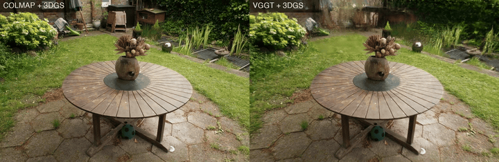
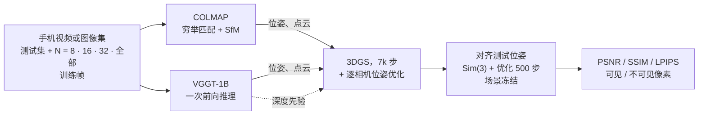

# VGGT-Splat

[English](README.md) | 简体中文

随手拍的手机视频 → [VGGT](https://github.com/facebookresearch/vggt) 前馈预测位姿、点云和深度 → 3D Gaussian Splatting，与常规的 COLMAP → 3DGS 流程对比。

**项目主页**：https://chu-jiaming.github.io/vggt-splat/ · **Release**：[v1.0.0](https://github.com/chu-jiaming/VGGT-Splat/releases/tag/v1.0.0)（训练好的模型、自拍数据）

<p align="center">
  
  <br>
  <em>garden，全部帧，训练 7k 步：两个模型沿同一条新视角环绕路径渲染（测试 PSNR 26.3 vs. 21.8 dB）。全分辨率视频见项目主页。</em>
</p>

**研究问题**

1. **帧数预算**：随手拍需要多少帧？在 8 / 16 / 32 / 全部训练帧下对比 COLMAP + 3DGS 和 VGGT → 3DGS。
2. **VGGT 深度先验**：帧数少时，用 VGGT 深度做监督能挽回多少质量？

6 个场景（自拍 desk / lawn / room；Mip-NeRF 360 garden / bicycle / counter）× 4 种帧数 × 3 种方法 = 72 次运行，另有多种子重复实验。

## 方法



- **COLMAP：** 标准前端，在 N 张训练帧上做穷举特征匹配和增量式 SfM。
- **VGGT：** VGGT-1B 一次前向推理预测全部 N 帧的相机、点图和深度；取置信度最高的 50% 点初始化高斯。
- **VGGT + depth：** 同上，另在训练视角上加一项渲染逆深度与 VGGT 深度之间的 Pearson 损失（λ = 0.2）。
- **评测：** 测试相机来自训练帧 + 测试帧的单独联合运行，用在训练相机上拟合的 Sim(3) 映射到各模型的坐标系，再冻结高斯进行优化。测试图像不会更新场景。

完整协议见 [实验协议](#实验协议)。

## 结论

1. **帧数预算。** 少于大约 16–32 帧时，两种前端中只有 VGGT 能稳定得到重建：COLMAP 在 N = 8 时 6 个场景失败 4 个，N = 16 时失败 3 个，而 VGGT 从未失败。用 110–180 帧的完整拍摄时，看重质量就应选 COLMAP，它在 6 个场景中的 5 个上领先 2.1–4.6 dB；VGGT 估计位姿仍快 3.5–13 倍，代价就是这段质量差距。
2. **VGGT 深度先验。** 它没有带来可测量的新视角质量提升：它让渲染深度更接近 VGGT 的深度，但在多种子重复实验中只有两处差异超出噪声（desk N = 32 低 0.68 dB，lawn N = 8 高 0.17 dB）。帧数少时，误差集中在没有任何训练视角看到的区域，训练视角上的深度损失管不到这些区域；真正有用的是更多视角，或能覆盖未见区域的先验。

## 主要发现

1. **帧少时 VGGT 可靠、COLMAP 不可靠；帧多时 COLMAP 更好。交叉点约在 N = 16–32。**
   N = 8 时，COLMAP 在 6 个场景中的 4 个上直接失败，其余两个也只注册了 3/8 和 6/8 个训练帧；N = 16 时它在 3 个场景上失败，另有两个只注册了 3/16（bicycle）和 7/16（desk）。VGGT 从未失败。使用全部帧时，COLMAP 在 5 个场景上领先 2.1–4.6 dB，在 desk 上领先 0.7 dB。
2. **全部帧时，VGGT 输在精度而不是覆盖。** 只看训练视角确实看得到的测试像素，VGGT 仍然落后（garden 21.7 vs 26.3 dB，bicycle 20.7 vs 22.8，counter 24.9 vs 27.2）。它的渲染明显发糊（在 lawn、garden、bicycle 上 PSNR 比 N = 32 高，但 LPIPS 更差），这与前馈位姿彼此不够一致、3DGS 难以还原细节的解释相符。
3. **深度先验改变了几何，却没改变新视角质量。** 它把训练视角上渲染深度与 VGGT 深度的局部相关系数从 0.4–0.8 提高到 0.7–0.9，但在多种子重复实验中只有两处差异超出噪声：desk N = 32 差了 0.68 dB，lawn N = 8 好了 0.17 dB。
4. **帧少时，瓶颈是覆盖。** 没有被任何训练视角看到的测试像素比看得到的差 0.5–9 dB，且每帧的未见比例与 PSNR 强负相关。训练视角上的深度先验约束不到这些区域，这也解释了发现 3。
5. **噪声水平。** 同一配置换随机种子重跑，PSNR 的标准差为 0.06–0.35 dB，因此单次运行中小于约 0.3 dB 的差异不能下结论。
6. **速度。** VGGT 估计全部帧的位姿需要 47–73 s；COLMAP（穷举匹配，GPU）需要 167–790 s。

## 结果

测试 PSNR（dB），经过测试时位姿优化，在该场景、该 N 下所有可用方法都注册了的测试帧上取平均。`fail` 表示位姿估计或对齐失败，或对齐被判为不一致（中心误差 > 10%）。括号内是 COLMAP 未注册全部测试帧时的已注册 / 总测试帧数；其他方法在同一子集上取平均。

| 场景 | 方法 | N=8 | N=16 | N=32 | N=all |
|---|---|---:|---:|---:|---:|
| desk | COLMAP | fail | 25.75 (7/16) | 23.47 | **32.46** |
| desk | VGGT | **24.36** | **30.20** | **32.34** | 31.79 |
| desk | VGGT + 深度 | **24.36** | **30.20** | 31.79 | 30.97 |
| lawn | COLMAP | 13.75 (15/23) | fail | **18.67** (22/23) | **21.44** (22/23) |
| lawn | VGGT | **15.66** | **17.47** | 18.51 | 19.35 |
| lawn | VGGT + 深度 | 15.61 | 17.41 | 18.64 | 19.39 |
| room | COLMAP | fail | fail | fail | **23.40** (14/17) |
| room | VGGT | **13.77** | **16.62** | 18.24 | 21.20 |
| room | VGGT + 深度 | **13.77** | 16.52 | **18.54** | 21.64 |
| garden | COLMAP | 14.27 | **19.57** | **23.19** | **26.34** |
| garden | VGGT | 15.64 | 18.13 | 19.93 | 21.79 |
| garden | VGGT + 深度 | **15.70** | 18.17 | 19.99 | 22.39 |
| bicycle | COLMAP | fail | 12.03 (9/24) | 14.25 | **23.40** |
| bicycle | VGGT | 14.42 | **16.45** | 18.26 | 21.30 |
| bicycle | VGGT + 深度 | **14.46** | 16.08 | **18.28** | 20.93 |
| counter | COLMAP | fail | fail | 21.04 | **27.25** |
| counter | VGGT | 14.12 | **19.02** | 21.58 | 25.04 |
| counter | VGGT + 深度 | **14.40** | 18.72 | **22.44** | 24.71 |

COLMAP 在 desk 和 bicycle 的 N = 32 上只注册了 15/32 和 10/32 个训练帧，所以那里比 N = 16 还低。SSIM、LPIPS、耗时和失败列表由 `scripts/summarize.py` 生成（见下文）。

位姿估计耗时（s，单卡 RTX 4090，含模型加载和图像读写）：

| 场景 | COLMAP 全部帧 | VGGT 全部帧 |
|---|---:|---:|
| desk（110 帧） | 167 | 47 |
| lawn（156） | 790 | 60 |
| room（114） | 505 | 49 |
| garden（161） | 770 | 68 |
| bicycle（166） | 380 | 68 |
| counter（180） | 480 | 73 |

## 实验协议

- **数据。** 每个场景的帧分为测试集（去掉模糊帧后每 8 帧取 1 帧，与 Mip-NeRF 360 一致）和嵌套的训练集：从其余帧中均匀抽取 N = 8 / 16 / 32 / 全部帧（`scripts/extract_frames.py`）。自拍场景是 1080p 手机视频，以 3 fps 抽帧，按 960×540 训练；Mip-NeRF 360 场景使用 `images_4`。
- **位姿。** COLMAP 4.2.1 穷举匹配（`scripts/run_colmap.sh`），或 VGGT-1B 一次前向推理，所有帧共享一个相机，取置信度最高的 50% 点作初始化（`scripts/vggt_to_colmap.py`）。
- **训练。** gsplat 3DGS，带逐相机位姿优化（`--pose_opt`），在默认 30k 调度的第 7,000 步停止。深度先验变体额外加一项渲染逆深度与 VGGT 深度之间的 Pearson 损失，λ = 0.2（在 desk 上扫参确定）。
- **评测**（`scripts/eval.py`）。测试相机来自训练帧 + 测试帧的联合运行；用共同训练相机拟合的 Sim(3)（旋转由相机朝向求得，尺度和平移由相机中心求得）把它们映射到训练模型的坐标系；冻结高斯，每个测试位姿优化 500 步，之后测 PSNR / SSIM / LPIPS。各方法在所有方法都注册了的测试帧上比较。
- **分析。** `scripts/coverage_err.py` 按像素是否被任一训练视角看到来拆分测试误差；`scripts/depth_diag.py` 衡量渲染深度与 VGGT 深度的一致性；`scripts/seed_repeat.sh` 用种子 1 和 2 重跑选定配置。

## 复现

### 环境

在 Ubuntu 22.04、CUDA 12.8、单卡 RTX 4090（24 GB）、Python 3.11 上测试：

| 组件 | 版本 |
|---|---|
| PyTorch | 2.9.1 + cu128 |
| gsplat | commit `512d366`（源码编译） |
| VGGT | commit `a288dd0`，权重 `facebook/VGGT-1B` |
| COLMAP | 4.2.1，带 CUDA 编译 |

```bash
uv venv .venv --python 3.11 && source .venv/bin/activate
uv pip install torch==2.9.1 torchvision==0.24.1 --index-url https://download.pytorch.org/whl/cu128
git clone --recursive https://github.com/nerfstudio-project/gsplat.git && git -C gsplat checkout 512d366b67073d77ca099ede742683c165dfc23b && git -C gsplat submodule update --init --recursive
uv pip install setuptools wheel ninja && uv pip install -e gsplat --no-build-isolation
uv pip install -r gsplat/examples/requirements.txt --no-build-isolation
git clone https://github.com/facebookresearch/vggt.git && git -C vggt checkout a288dd0f14786c93483e45524328726ab7b1b4ce
uv pip install -e vggt --no-deps && uv pip install einops safetensors huggingface_hub trimesh hydra-core omegaconf
git clone https://github.com/chu-jiaming/VGGT-Splat.git
```

3DGS 训练使用本仓库的 `trainer/`，它是 gsplat 同一 commit 下 `examples/` 的修改版（改动见 [`trainer/NOTICE.md`](trainer/NOTICE.md)）；gsplat 库和 `trainer/` 必须保持在同一 commit。

### 数据

```
data/<scene>/frames/NNNN.jpg      全部帧
data/<scene>/splits/              test.txt、train_{8,16,32,all}.txt（由 extract_frames.py 生成）
```

- **Mip-NeRF 360**：下载 [`360_v2.zip`](https://jonbarron.info/mipnerf360/)，用软链接把 `data/<scene>/frames` 指向 `360_v2/<scene>/images_4`，再运行 `python scripts/extract_frames.py data/<scene>`。
- **自拍场景**（desk、lawn、room）：从 [v1.0.0 release](https://github.com/chu-jiaming/VGGT-Splat/releases/tag/v1.0.0) 下载 `vggt-splat_data_<scene>.zip`，在 `data/` 下解压；其中有抽好的 `frames/` 和本研究使用的 `splits/`（`joint_*.txt` 会由 `run_all.sh` 重新生成）。新拍的视频，在包含 `video.mp4` 的文件夹上运行 `python scripts/extract_frames.py data/<scene>`。

### 运行

`scripts/run_all.sh` 对每个场景 × 方法 × N 依次做位姿估计 → 联合运行 → 训练 → 评测，每次运行在 `results/<scene>.csv` 追加一行，并能从已有输出续跑。路径由环境变量指定：`DATA`、`RUNS`、`RESULTS`、`VENV`（虚拟环境，其 `bin/` 放在 `PATH` 最前）、`HF_HOME` / `TORCH_HOME`（权重缓存）和 `HF_ENDPOINT`（默认 `https://hf-mirror.com`；在中国大陆以外请设 `HF_ENDPOINT=https://huggingface.co`）。`SCENES`、`METHODS`、`NS` 用来选子集，例如 `SCENES=garden NS=8` 约 10 分钟即可跑完一次检查。

```bash
export VENV=$PWD/.venv DATA=$PWD/data RUNS=$PWD/runs RESULTS=$PWD/results
SCENES="desk lawn room garden bicycle counter" METHODS="colmap vggt" scripts/run_all.sh
SCENES="desk lawn room garden bicycle counter" METHODS=vggt_depth DEPTH_LAMBDAS=0.2 scripts/run_all.sh
python scripts/summarize.py --results results --runs runs       # 表格、曲线、失败列表 → results/summary/
```

分析与导出：

```bash
python scripts/coverage_err.py --runs runs --out results/coverage.csv     # 加 --save_maps 输出 GT | 渲染 | 误差 | 覆盖 对比图
python scripts/depth_diag.py --runs runs --out results/depth_diag.csv
scripts/seed_repeat.sh job desk vggt_depth 32 1 0.2 && scripts/seed_repeat.sh summary
python scripts/export_splats.py --runs runs --out results/export --list "garden/vggt_all garden/colmap_all"   # .splat + 压缩 .ply
RUNS=runs scripts/rerender_traj.sh garden/vggt_all garden/colmap_all   # 用已有 checkpoint 渲染更慢的漫游视频（450 帧）
python scripts/render_orbit.py --runs runs --out results/orbit --scene garden --frames 600   # COLMAP 和 VGGT 模型沿同一条新视角环绕路径渲染
```

一次运行（位姿估计、联合运行、7k 步训练、评测）在 RTX 4090 上约 5–10 分钟，COLMAP 用全部帧时最长约 35 分钟。

### 训练好的模型

[v1.0.0 release](https://github.com/chu-jiaming/VGGT-Splat/releases/tag/v1.0.0) 提供每个场景全部帧的 COLMAP 和 VGGT 模型（`<scene>_<colmap|vggt>_all`，第 7,000 步），由 `scripts/export_splats.py` 导出为两种格式：

- `.splat`（7–144 MB）：只有基础颜色，用于支持 antimatter15 `.splat` 格式的网页查看器。
- `.compressed.ply`（13–276 MB）：PlayCanvas 压缩 PLY，含球谐系数，可用 [SuperSplat](https://superspl.at/editor) 等查看器打开。

每个模型都在各自归一化的世界坐标系里，因此同一场景的 COLMAP 和 VGGT 模型彼此没有对齐；`scripts/render_orbit.py` 演示了如何把一个映射到另一个。`SHA256SUMS` 列出了每个文件的校验值。

## 局限

- 每个场景只拍了一次；主实验网格每个配置只跑了一个种子，多种子重复只覆盖部分配置。
- 所有运行都在 7k 步停止。在 desk N = 16 上，同一运行的 30k checkpoint 在测试帧上略差（多出的步数过拟合了训练视角），方法排名不变；其他配置没有检查。
- 帧数少时 COLMAP 的结果不确定。在全新环境中复现 garden N = 8：VGGT 得到 15.67 dB（本文 15.64），但 COLMAP 只注册了 5/8 个训练帧（本文 6/8），得到 13.35 dB（本文 14.27）；在同样的帧上再单独跑 5 次 COLMAP，都注册了 6/8。
- 覆盖拆分用各模型自己的几何来判断哪些像素被看到，因此只是近似。
- 测试相机来自单独的联合运行，并在冻结场景的情况下优化；这是无位姿方法的标准协议，但仍与用真值测试位姿评测不同。

## 许可证

本仓库代码以 [MIT License](LICENSE) 发布，`trainer/` 除外：它改编自 gsplat，以 Apache License 2.0 发布（见 [`trainer/NOTICE.md`](trainer/NOTICE.md)）。

第三方模型和库沿用各自的许可证。特别地，VGGT 权重按其原始许可证使用（仅限非商业用途），详见 VGGT 仓库。
